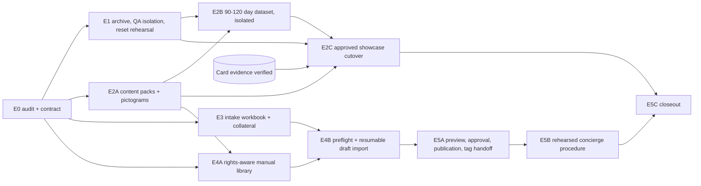

# Engineering Phase E — showcase fleet and repeatable pilot implementation (plan of record)

**Status:**
- E0 complete on branch `phase-e/showcase-onboarding` (2026-10-14).
- Grouped approval received 2026-10-16 ([DECISIONS.md](DECISIONS.md)).
- **E1 complete (2026-10-17):**
  - a verified Production archive, restored and reset-rehearsed in isolation;
  - QA isolation guards;
  - the guarded reset interface, which only dry-runs against Production.
  See [DEMO_RECOVERY_RUNBOOK.md](DEMO_RECOVERY_RUNBOOK.md).
- **E2A complete (2026-10-17):** four sourced content packs in [packs/](packs/README.md), with 20 original pictogram panels, three Start-Up Guide PDFs, the source and rights register, field-level E2C import manifests and marketing candidates. Nothing is published. Reworked picture-first the same day after the operator's gallery review: panels redrawn as short frame sequences with no words, 24 safety sign tiles, accessory icons, two-page picture guides and a gallery with almost no visible text. Open items (the trailer photos, the E20 manual, the knowledgeable review, Big Tex's answers) are listed in the [work log](WORK_LOG.md).
- E2B is next. It starts only when the operator runs it, **never** automatically.

This phase is not the older roadmap's "Phase E", and it is not an operational-hold phase.

**Companion documents:**

| Document | Contents |
|---|---|
| [PROTECTED_DEMO_ROUTES.md](PROTECTED_DEMO_ROUTES.md) | Immutable routes and the artwork register |
| [CANONICAL_SHOWCASE_FLEET.md](CANONICAL_SHOWCASE_FLEET.md) | Identities, stories, history, archive boundary |
| [ONBOARDING_DATA_CONTRACT.md](ONBOARDING_DATA_CONTRACT.md) | Content contract and schema |
| [DECISIONS.md](DECISIONS.md) | Binding decisions, non-goal reconciliation, approval request |
| [DEMO_RECOVERY_RUNBOOK.md](DEMO_RECOVERY_RUNBOOK.md) | Archive custody, restore, reset planner, seed-notification suppression, QA isolation, E2C cutover and rollback checklists |
| [WORK_LOG.md](WORK_LOG.md) | Approvals, hashes, next command |

## 1. Dependency map

| Slice | Needs | Delivers | Production effect | Gate before Production |
|---|---|---|---|---|
| E1 | E0 approval item 2 | Recoverable Northridge archive (rows + Storage bytes + hashes, outside Git); guarded, dry-run-first restore tooling; rehearsal in isolation; staging QA orgs as the destructive target | Archive **reads** only | Restore rehearsed and verified against the audit counts |
| E2A | Items 1 and 4; the OMM purchase decision; photos | Four sourced content packs in the [contract schema](schema/equipment-content.schema.json); original pictographic artwork reviewed against the OEM manuals | None until approved | Qualified review of every step; rights recorded |
| E2B | E1, E2A, item 3 | Deterministic 105-day dataset and loader; synthetic manifest (pinned ids); runs on staging first | None | Loader refuses above the digest watermark; non-overlap and arithmetic tests |
| E2C | E1 rehearsal, E2A, E2B, **verified card evidence**, printed-sheet answers, the QR-disable guard | Showcase content behind the unchanged routes | Explicitly approved, recoverable, demo-only cutover with an exact protected-id manifest | Separate Production approval naming ids; promotion of an exact tested commit |
| E3 | Item 5 | Customer intake workbook, examples, instructions, operator templates | None | — |
| E4A | Items 1 and 5 | Rights-aware hosted manual library; one revision referenced by many assets; dedup within a rights class | Additive, approved release | Migration approvals (staging, then Production) |
| E4B | E3, E4A | Owner-led preflight, bounded enrichment, resumable idempotent draft import into dedicated test orgs first; QA report; never auto-publish | Test orgs first | Migration approvals |
| E5A | E4B | Customer preview, versioned approval record, controlled publication, tag handoff | Approved initial-onboarding workflow only | Approval language legally reviewed |
| E5B | E5A | Rehearsed concierge procedure on synthetic 25/100/250-asset batches; measured times | Synthetic only | — |
| E5C | All | Integrated closeout and operating handoff | Verification only (and separately approved fixes) | Full security and E2E runs |

## 2. Existing code to reuse (do not rebuild)

| Capability | Where |
|---|---|
| Organization creation (owner only, RLS backstop, no service role) | `lib/org/actions.ts:168` `createOrganization` |
| Invites (owner into any org; customer admin into own org; link-based, no email) and invite regeneration | `lib/team/actions.ts:152` `inviteUser`, `:286` `regenerateInvite` |
| CSV import: 15 columns, page templates, return-template keys, draft flags | `lib/onboarding/import.ts`, `lib/onboarding/actions.ts:50` (customer admin only) |
| Category page templates (8) | `lib/onboarding/templates.ts:31-185` |
| Return and outbound templates (6 each); category defaults; versioned templates | `lib/inspections/templates.ts:128`, `lib/inspections/outbound-templates.ts:109`, migrations 0025/0026 |
| Accessory issue/return comparison | `lib/inspections/accessories.ts` |
| QR creation, custom codes, governance (production primary, supersedes) | `lib/qr/actions.ts:30`, `lib/qr/custom-code.ts`, `0023_qr_short_code_rotation.sql` |
| Owner production outputs (SVG, print sheet, CSV) | `/owner/production/*`, `lib/qr/svg.ts` |
| Tag requests and owner status flow | `0010`, `0011`, `0035`; dashboard tag requests (admin only) |
| Notification routing and the daily digest (America/Vancouver, ledger watermark) | `lib/notifications/*`, `0034`, `0036` |
| Target guard for scripts | `scripts/lib/env-target.mjs` (`assertTarget`, known Production ref) |
| Storage walking with paging and depth caps | `scripts/cleanup-orphan-media.mjs:62` `listBucket` |
| Production notification and digest read-out | `npm.cmd run production:notification-config` |
| Staging QA fixtures | `scripts/staging/seed-staging-qa.mjs` (orgs A `…57a610`, B `…57a620`) |
| **New in E0:** vector QR decoder and read-only fixture inventory | `scripts/lib/qr-decode.mjs` (`phase-e:decode-qr`), `scripts/lib/showcase-inventory.mjs` (`phase-e:audit:{production,staging}`) |

## 3. Minimal additions (named, not built)

| Addition | Slice |
|---|---|
| Owner-only guard for disabling a protected or production-primary QR row (migration) | Before E2C |
| Archive exporter and restore rehearsal tooling (extends the E0 inventory; dry-run, manifest, confirmation) | E1 — **built**: `phase-e:archive:*`, `phase-e:restore`, `phase-e:reset:*`, `phase-e:health:production` |
| Chronological demo loader; synthetic manifest; watermark refusal | E2B |
| Photo attribution line; pictogram rendering in guidance | E2A **proposed** ([packs/EXTENSIONS.md](packs/EXTENSIONS.md)); interim: baked credit label and the Start-Up Guide PDF. Build in E4A |
| Source register and shared document revisions; rights fields | E4A |
| Owner batch import for an explicit org (idempotent upsert, coverage pre-check, surfaced errors, publish off); content review status; run log | E4B |
| Approval record | E5A |
| **Optional:** `noindex` on `/t/` and crawler-aware scan reporting; org-scoped seeding suppression (only if the watermark rule cannot hold) | — |

## 4. Acceptance gates (whole phase)

- **Routes:** protected routes unchanged (ids, codes, status, lineage), re-verified by the decoder and the inventory before and after every Production change.
- **No destructive cutover** without card evidence, a rehearsed restore, and an exact-id Production approval.
- **No email, digest or contact attempt** generated by seeding. No global notification suppression.
- **Content:** every published guidance step has a source and a reviewer, and every public file has cleared rights.
- **Approvals and gates:** separate approvals for migrations (staging, then Production), Production deletions, publication and tag release, and promotion of an exact tested commit. Lint, typecheck, unit tests and build after meaningful changes; security and E2E at cross-cutting releases and closeout. Skips are labelled.

## 5. Runbook reconciliation: `docs/ONBOARDING_RUNBOOK.md` vs current behaviour

| Runbook claim | Current behaviour | Evidence | Reuse or gap |
|---|---|---|---|
| L7: onboarding "through the Supabase dashboard (or SQL)" | Organizations are created in the owner UI | `lib/org/actions.ts:168` (`requireRole(PLATFORM_OWNER)`) | Reuse |
| L24: "Staff mirrors customer admin" | Staff are limited. Settings, users, export, tag requests, templates, import and submission export are admin only. Staff keep assets, submissions, rentals, analytics and **QR on/off** | `lib/auth/admin-routes.test.ts:12-42`, `lib/auth/session.ts:178`, `lib/qr/actions.ts:96-120` | **Gap:** staff (and admins) can disable a printed code |
| L73, L335: "Apply all migrations in order (`0001`–`0006`): `supabase db push`" | Schema is `0001`–`0039` per the ledger. Production changes need staging-then-Production approvals; the CLI stays linked to staging | `docs/MIGRATION_LEDGER.md`, `docs/PRODUCTION_DEPLOYMENT_RUNBOOK.md` | Outdated |
| L76: "Apply `supabase/seed.sql` to load the Northridge demo org and four demo assets" | `seed.sql` holds **10** assets plus synthetic submissions, tag requests and documents. Production Northridge is the showcase | `supabase/seed.sql:3-12` | **Hazard:** never run on a hosted DB |
| L90-111: insert the platform-admin `profiles` row by SQL | Still the bootstrap path for the **first** owner only | — | Keep, bootstrap only |
| L120, L151-160: customer admin via "Supabase invite / magic-link email" plus a SQL profile insert | `inviteUser` creates the auth user and profile and returns an invite **link**. **No email is sent**; custom auth SMTP is not configured | `lib/team/actions.ts:152`, `:238-241`, `:286`; `docs/SUPABASE_AUTH_CONFIG.md`; `docs/ROADMAP_DEFERRED.md` #11 | Reuse; branded invite email deferred |
| L128-150: create the organization by SQL insert | `createOrganization` sets plan fields on insert. No assets, users or demo data | `lib/org/actions.ts:160-197` | Reuse |
| L175-245: assets, QR links and documents by SQL | Asset UI and CSV import (customer admin only); QR creation in the UI; documents UI | `lib/onboarding/actions.ts:50`, `lib/qr/actions.ts:30` | **Gap:** the owner has no org, so owner-led batch import does not exist (E4B) |
| L289-302: owner production SVG, print sheet and CSV | Exists | `/owner/production/*` | Reuse for tag handoff (E5A) |

`docs/ONBOARDING_RUNBOOK.md` now carries a banner pointing here. Its historical text is kept.

### Role matrix (current)

| Capability | Platform owner | Customer admin | Customer staff |
|---|---|---|---|
| Create organizations; owner production tools; owner export | ✓ | — | — |
| Invite users | Any org (non-owner roles) | Own org | — |
| Settings, users, templates, import, tag requests, exports | via owner routes | ✓ | — |
| Assets, pages, documents, QR **activate/deactivate** | ✓ | ✓ | ✓ (`setQrLinkStatus` checks only `requireProfile`) |
| Submissions, rentals (outbound/return), analytics | Not through `/dashboard`: the owner has no org context | ✓ | ✓ |
| Content writes as owner | Blocked: the owner profile has no org | — | — |
